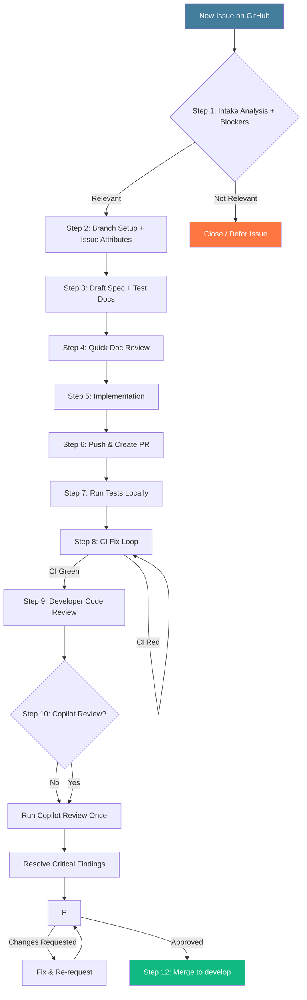
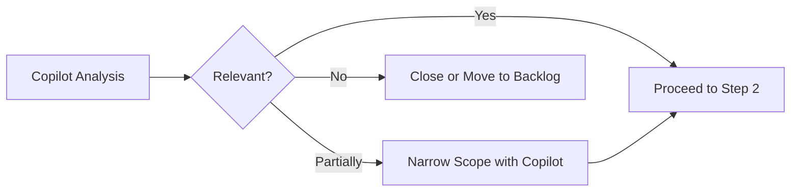
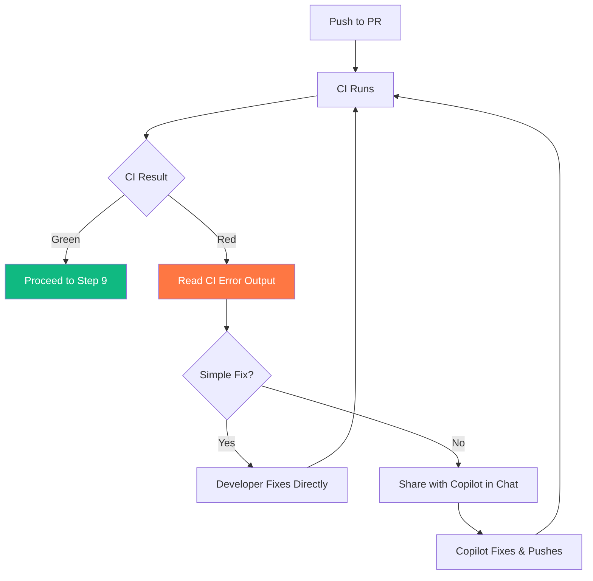
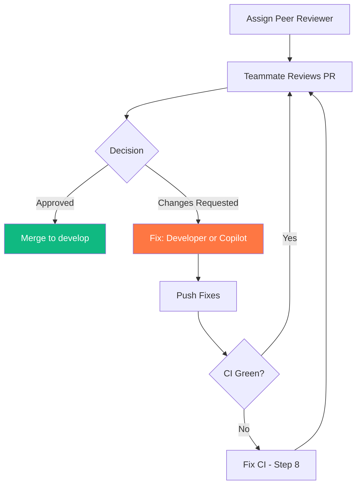
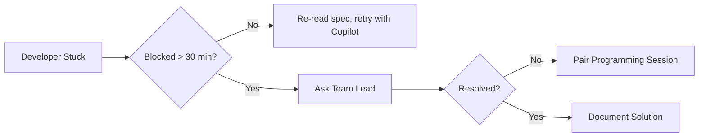

# Issue Handling Process Guideline

> **Version**: 1.4
> **Last Updated**: 2026-06-14
> **Audience**: All MALLOULINOVA developers
> **Owner**: Engineering Lead

---

## Table of Contents

1. [Purpose](#1-purpose)
2. [Prerequisites & Configuration](#2-prerequisites--configuration)
3. [Process Overview](#3-process-overview)
4. [Detailed Workflow](#4-detailed-workflow)
5. [Commands Reference](#5-commands-reference)
6. [Rules & Constraints](#6-rules--constraints)
7. [Troubleshooting](#7-troubleshooting)

---

## 1. Purpose

This document defines the **standard issue handling process** at MALLOULINOVA. Every developer must follow this workflow to ensure:

| KPI | Target | Measurement |
|-----|--------|-------------|
| **Speed** | Issues resolved within sprint cycle | Time from branch creation to PR merge |
| **Consistency** | Same process regardless of developer | Adherence to this guideline (peer review) |
| **Correctness** | Zero regressions, CI green before merge | Test pass rate, rollback frequency |

---

## 2. Prerequisites & Configuration

### 2.1 Required Tools

| Tool | Version / Config | Purpose |
|------|-----------------|---------|
| VS Code | Latest stable | Primary IDE |
| GitHub Copilot Chat | Latest | AI pair programming |
| AI Model | **Auto** (switch manually to another model if it starts hallucinating) | Default model selection |
| GitHub MCP | **Enabled** | Issue & PR read access for Copilot |
| Supabase CLI | Latest | Local database testing |
| Node.js | 22.x LTS (>=22.12) | Runtime (Supabase native WebSocket, Vite 8 compatibility) |
| Git | Latest | Version control |


### 2.2 Repository Setup

- Default branch: `develop`
- Branch naming: `feature/<issue-number>-<short-description>`
- Instruction files: `.github/instructions/` (auto-loaded by Copilot)

---

## 3. Process Overview



### Cost-First Operating Mode (Default)

- Default mode is **cost-first**: use the minimum AI turns needed to safely deliver the issue.
- Copilot review is **optional** and risk-based.
- CodeRabbit review is **mandatory** when Copilot review is skipped.
- Prefer short, structured prompts and targeted CI snippets over long free-form context.

### AI Chat Credit Threshold Policy (RAG)

Use this Red/Yellow/Green policy to decide when prompt usage is too expensive. Thresholds are calibrated for a large monorepo with multiple complex features.

| Level | Credits per prompt (avg) | Daily credits per developer | Required Action |
|------|---------------------------|-----------------------------|----------------|
| **Green** | `<= 40` | `<= 200` | Continue normal workflow |
| **Yellow** | `41-80` | `201-320` | Next day: use strict one-task templates; cap logs to 20-40 lines; minimize context |
| **Red** | `> 80` | `> 320` | Next day: pause broad prompting; use reproduce -> patch -> verify; minimal-diff only |

**Escalation rule:**
- If daily average stays in **Red** for 3 consecutive working days, team lead must review prompt patterns and enforce template-only mode for the following week until average returns to **Yellow/Green**.

### Copy-Paste Prompt Template System (Low-Credit Mode)

Use these templates to keep prompts short, targeted, and low-cost. Default to one template per request.

**Global rules (always apply):**
- One task per prompt.
- One error and one target file at a time when possible.
- Include only the first 20-40 relevant log lines.
- Ask for minimal patch and no refactor unless explicitly needed.
- Request this output format: cause, files changed, patch summary, verification.

**Template A — Fix one failing test**

```text
Goal: fix one failing test with minimal edits.
Test file: <path>
Test name: <name>
Error: <exact failing line>
Target file: <path>
Constraints: minimal patch only; no refactor; run only this test.
Output: cause, files changed, patch, test result.
```

**Template B — Fix one CI failure**

```text
Goal: fix one CI failure only.
Workflow/job: <name>
Failing step: <name>
Error snippet: <20-40 lines>
Target file: <path or unknown>
Constraints: fix only this failure; no unrelated changes.
Output: cause, fix, verification command, result.
```

**Template C — Implement one small change**

```text
Goal: implement one requirement.
Requirement: <single sentence>
Scope in: <files/folder>
Scope out: no redesign; no architecture change; no dependency changes unless required.
Constraints: smallest working diff.
Output: files touched, change summary, verification.
```

**Template D — Docs sync only**

```text
Goal: update docs to match current code/policy.
Source of truth: <file>
Doc to update: <file>
Constraints: no code changes; concise wording; remove stale specifics.
Output: sections updated, consistency summary.
```

**Template E — Focused review**

```text
Goal: review changed files for regressions only.
Scope: changed files in diff.
Check: behavior regression, missing tests, security risk.
Constraints: no style-only comments.
Output: findings ordered by severity with file references.
```

---

## 4. Detailed Workflow

### Step 1 — Intake Analysis, Relevance & Blockers (Merged)

**Objective**: Validate the issue against project scope (MVP) before investing effort.

**Action**: Give Copilot read access once and request a single intake analysis.

```
@chat #issue_read https://github.com/Malloulinova/mallouliauto/issues/<NUMBER>

Analyze this issue in one pass:
1. Summarize the requirements
2. Check relevance against our MVP scope and current project status
3. Validate requirement clarity and technical feasibility
4. Identify dependencies or blockers
5. Estimate complexity (S/M/L/XL)
6. Give a go/no-go recommendation
```

**Expected Output from Copilot**:

| Field | Description |
|-------|-------------|
| Summary | 2-3 sentence requirement overview |
| MVP Relevance | ✅ In scope / ⚠️ Partial / ❌ Out of scope |
| Requirements Validity | ✅ Clear & valid / ⚠️ Needs clarification / ❌ Invalid or contradictory |
| Dependencies | List of prerequisite issues or migrations |
| Blockers | List of blockers with issue/PR references, or "None" |
| Complexity | S (< 2h) / M (2-4h) / L (4-8h) / XL (> 8h) |
| Recommendation | Proceed / Defer / Needs clarification |

**Decision Gate**:



---

### Step 2 — Branch Setup & Issue Attributes

**Objective**: Create the working branch and configure issue tracking after Step 1 confirms no blockers.

**Decision Gate**:
- If blockers exist → **stop**, resolve them or flag to team lead before continuing
- If requirements are ambiguous → clarify with issue author before coding
- Only proceed when Step 1 is valid and unblocked

**Actions** (Developer — manual):

1. **Fill issue attributes on GitHub**:
   - Assignee: yourself
   - Labels: `priority/P0`, `type/feature`, etc.
   - Milestone: current sprint
   - Project: link to board

2. **Create feature branch**:

```bash
git checkout develop
git pull origin develop
git checkout -b feature/<issue-number>-<short-description>
```

**Branch Naming Convention**:

| Pattern | Example |
|---------|---------|
| `feature/<id>-<desc>` | `feature/32-p0-03-row-level-security-rls-policies-for-all-tables` |
| `fix/<id>-<desc>` | `fix/45-storage-upload-timeout` |
| `hotfix/<id>-<desc>` | `hotfix/50-prod-crash-login` |

---

### Step 3 — Draft Specification & Test Documents

**Objective**: Generate implementation and test specification docs BEFORE writing any code.

**Action**: Request Copilot to draft both documents.

```
Based on issue #<NUMBER>, create:
1. Implementation specification → doc/specifications/<filename>.md
2. Test specification → doc/tests/<filename>_test_specification.md

Follow the project's spec format and include:
- Architecture decisions
- Data model changes (if any)
- Step-by-step implementation plan
- Test scenarios (happy path, edge cases, security)
```

**Output Structure**:

```
doc/
├── specifications/
│   └── <issue_slug>_implementation_spec.md
└── tests/
    └── <issue_slug>_test_specification.md
```

**Spec Document Template** (minimum sections):

| Section | Content |
|---------|---------|
| Overview | What, why, affected areas |
| Architecture | Design decisions, data flow |
| Implementation Steps | Ordered list of changes |
| Migration Plan | DB changes if applicable |
| Rollback Strategy | How to undo if needed |

**Test Document Template** (minimum sections):

| Section | Content |
|---------|---------|
| Test Strategy | Unit / Integration / E2E split |
| Test Scenarios | Table with ID, description, expected result |
| Test Data | Mock data requirements |
| CI Integration | How tests run in pipeline |

---

### Step 4 — Review & Iterate on Docs

**Objective**: Align specifications with actual requirements before coding.

**Actions**:

1. **Read** both generated documents carefully
2. **Identify gaps**: missing edge cases, wrong assumptions, scope creep
3. **Iterate with Copilot only if needed**:

```
In the spec doc, I need to adjust:
- [Specific change 1]
- [Specific change 2]

Update the documents accordingly.
```

**Completion Criteria**:

- [ ] All requirements from the issue are covered
- [ ] No scope creep beyond the issue
- [ ] Test scenarios cover happy path + error cases
- [ ] Architecture aligns with existing codebase patterns
- [ ] You can explain the plan to a teammate in 2 minutes

---

### Step 5 — Implementation

**Objective**: Execute the implementation plan from the spec docs.

**Action**: Request Copilot to implement step by step.

```
The spec docs are approved. Please:
1. Set up a step-by-step implementation plan (todo list)
2. Proceed with the implementation following the spec
3. Commit logical units of work as you go
```

**Rules During Implementation**:

| Rule | Rationale |
|------|-----------|
| Follow the spec — don't over-engineer | Prevent scope creep |
| One logical change per commit | Easy rollback & review |
| Push incrementally after each logical milestone | Smaller diffs are easier to review, reduces merge conflicts, and makes CI feedback faster |
| Run tests after each major step | Catch regressions early |
| Use project conventions (see `.github/instructions/`) | Consistency |

> **Push Strategy**: Do NOT accumulate all changes into one massive push at the end.
> Push after each completed milestone (e.g., migrations done → push, tests written → push, docs updated → push).
> This gives earlier CI feedback and makes the PR easier to review commit-by-commit.

### Step 6 — Push & Pull Request Creation

**Objective**: Get code on GitHub and create the PR for review.

**Actions**:

1. **Copilot pushes** (or you push manually):

```bash
git push -u origin feature/<issue-number>-<short-description>
```

2. **Create Pull Request on GitHub** (Developer — manual):

| PR Field | Value |
|----------|-------|
| Title | `feat: <Issue title> (#<issue-number>)` |
| Description | Link to issue, summary of changes, test instructions |
| Base branch | `develop` |
| Reviewers | Optional at PR creation; assign peer reviewer in Step 11 |
| Labels | Same as issue |
| Linked issues | `Closes #<issue-number>` |

---

---

### Step 7 — Local Test Execution

**Objective**: Verify required local tests pass before pushing.

**Action**: If Copilot hasn't already run tests, request explicitly:

```
Run required local tests and fix any failures before pushing.
```

**Required local test gate**:
- Always run: unit + integration suites.
- Run critical E2E locally when the change touches auth, role routing, permissions/RBAC, or protected route behavior.
- Critical E2E membership is defined in `playwright.config.ts` (`testMatch`) and should not be duplicated in this document.

**Gate**: Do NOT proceed to Step 8 unless required local tests pass.

**Mandatory**: After tests pass, update [`doc/tests/test_coverage_plan.md`](../tests/test_coverage_plan.md):
- Add new test files/suites to the inventory (§1)
- Update coverage gaps status from ❌ to ✅ if addressed (§2)
- Adjust test counts to reflect current totals
- Move completed areas from "Planned" to "Current Inventory"

---

### Step 8 — CI Pipeline Fix Loop (Token-Efficient)

**Objective**: Ensure all CI checks pass (lint, type-check, tests).



**Action**: Share a targeted CI snippet first:

```
I got CI failures. Here is the minimal failing context:

- Workflow/job name:
- Failing step:
- First error stack trace + ~20 lines around it:
- Commit SHA:

Please fix them.
```

**Rules**:
- Share **minimal failing context first**; share full logs only if first fix attempt is insufficient
- For simple/obvious fixes (e.g., a missing import, a typo), the developer **may fix manually** — this is often faster and cheaper than a Copilot round-trip
- For complex or unclear errors, **prefer letting Copilot fix and push** to avoid introducing new issues
- Maximum 3 iterations — if still failing, escalate to team lead

---

### Step 9 — Developer Code Review (Required)

**Objective**: The developer reviews ALL code and tests before requesting peer review. The code is **yours** — you own it.

**Actions**:

1. **Review every changed file** — don’t just skim
2. **Walk through the checklist below**
3. **Fix issues** — for trivial fixes (typo, missing import, formatting), fix directly; for non-trivial issues, request Copilot to fix
4. Push any fixes discovered during review

**Developer Review Checklist**:

| Check | What to look for |
|-------|------------------|
| Logic correctness | Does the code do what the spec says? Any off-by-one, missing edge cases? |
| Naming & readability | Clear variable/function names, no cryptic abbreviations |
| No over-engineering | No extra abstractions, helpers, or features beyond the spec |
| Spec compliance | Every spec requirement addressed, nothing skipped |
| No leftover debug code | No `console.log`, commented-out blocks, TODO hacks |
| Convention compliance | Brand colors, Lucide icons, French accents, no third-party names in UI |
| Test quality | Tests cover happy path + edge cases, proper AAA pattern, meaningful assertions |
| Security | No hardcoded secrets, proper input validation at boundaries |

**Gate**: Do NOT proceed unless code quality is production-ready.

---

### Step 10 — Automated Review Policy (Copilot Optional, CodeRabbit Mandatory Fallback)

**Objective**: Keep token usage low while ensuring every PR gets at least one automated review pass.

**Trigger Criteria for Copilot** (run Copilot if any apply):
- Complexity is **L/XL**
- Security/authentication/authorization changes
- Database migrations or policy changes
- Cross-cutting refactors touching many modules
- Reviewer explicitly requests automated review

If none apply, skip Copilot and run CodeRabbit instead.

**Copilot (single pass, optional)**:

```
#pull_request_read https://github.com/Malloulinova/mallouliauto/pull/<NUMBER>
#issue_read https://github.com/Malloulinova/mallouliauto/issues/<NUMBER>

Please do one review pass with two sections:
1. Requirements/spec coverage gaps
2. Code quality/security/performance findings
```

**CodeRabbit (single pass, mandatory when Copilot is skipped)**:
- If Copilot review is skipped, CodeRabbit review must be completed before peer review
- Resolve critical comments or dismiss clear false positives with rationale

**Rules**:
- Single pass only (no repeated re-review loops)
- Fix high/critical findings first
- If fixes break CI, return to Step 8
- At least one automated review must be completed: Copilot or CodeRabbit

---

### Step 11 — Peer Review

**Objective**: A teammate performs final human review before merge.

Proceed only when:
- CI is green
- Developer review (Step 9) is complete
- Automated review findings (Step 10) are handled

---

### Step 12 — Merge

**Objective**: A teammate performs the final human review before the PR is merged.

**Actions** (Developer — manual):

1. **Resolve any merge conflicts** — rebase or merge `develop` into your branch and ensure the PR shows no conflicts before requesting review
2. **Assign a teammate** as reviewer on the PR
3. **Notify them** via team channel with a brief summary of what changed

**Peer Reviewer will**:
- Review for business logic correctness
- Check architecture alignment with existing patterns
- Verify readability and maintainability
- Approve or request changes

**Review Loop**:



**Rules**:
- PRs **cannot be merged** without at least one teammate approval
- The PR author **cannot** approve their own PR
- If the reviewer is unavailable for >24h, escalate to team lead for reassignment
- After merge, delete the feature branch

**Gate**: PR is merged ONLY when:
- [ ] CI is green
- [ ] Developer has reviewed all code (Step 9)
- [ ] Automated review findings (Step 10) are resolved
- [ ] Teammate has approved
- [ ] No unresolved conversations

---

## 5. Commands Reference

### Copilot Chat Commands

| Command | When to Use | Example |
|---------|-------------|---------|
| `#issue_read <URL>` | Step 1 — Analyze issue | `#issue_read https://github.com/Malloulinova/mallouliauto/issues/32` |
| `#pull_request_read <URL>` | Step 10 — Copilot optional review | `#pull_request_read https://github.com/Malloulinova/mallouliauto/pull/123` |

---

## 6. Rules & Constraints

### Mandatory Rules

| # | Rule | Consequence of Violation |
|---|------|--------------------------|
| 1 | **Use Auto model by default**; switch manually to another model only if it starts hallucinating | Inconsistent output quality |
| 2 | **GitHub MCP must be enabled** | Cannot read issues/PRs |
| 3 | **Spec docs before code** — no exceptions | PR will be rejected |
| 4 | **Required local tests must pass** (unit + integration always, critical E2E for auth/roles/permissions changes) before CI fix loop | CI will fail, wastes pipeline minutes |
| 5 | **Follow branch naming convention** | Rejected by branch protection rules |
| 6 | **One issue = one branch = one PR** | Keep changes atomic |
| 7 | **Never force-push** without team lead approval | Risk of losing teammates' work |
| 8 | **Never deploy to production** without explicit approval | See deployment policy in `agents.instructions.md` |
| 9 | **Update `doc/tests/test_coverage_plan.md`** after adding/changing tests | Test inventory becomes stale, team loses visibility |
| 10 | **Push incrementally** — never batch all changes into one giant push | Large pushes are hard to review, delay CI feedback, increase merge conflict risk |
| 11 | **Developer review is mandatory** before peer review | Protects quality when automated review is skipped |
| 12 | **Copilot review is optional and risk-based** | Reduces unnecessary token usage on low-risk PRs |
| 13 | **If Copilot is skipped, CodeRabbit review is mandatory** | Ensures automated review coverage with controlled token cost |
| 14 | **Peer review required before merge** — a teammate must approve | Prevents single-person blind spots, ensures shared code ownership |

### Copilot Interaction Rules

| Rule | Details |
|------|---------|
| Share full context | Always give Copilot the issue link, not just a summary |
| Don't guess — ask | If Copilot's output seems wrong, iterate with Copilot. For obvious one-line fixes the developer may correct directly |
| Trust but verify | Review generated specs before approving implementation |
| One task at a time | Don't mix multiple issues in one conversation |
| Fresh chat per issue | Start a new Copilot chat session for each new issue |

### Code Standards (Enforced)

| Standard | Reference |
|----------|-----------|
| TypeScript strict mode | `tsconfig.json` |
| NativeWind/Tailwind styling | `tailwind.config.js` |
| Brand colors only | See `agents.instructions.md` §4.2 |
| Lucide icons (no emojis) | See `agents.instructions.md` §4.1 |
| French with accents | See `agents.instructions.md` §4.7 |
| No third-party names in UI | See `agents.instructions.md` §4.8 |

---

## 7. Troubleshooting

### Common Issues

| Problem | Cause | Solution |
|---------|-------|----------|
| Copilot can't read issue | MCP not enabled | Check VS Code settings, restart Copilot |
| CI fails with config errors | Supabase CLI version mismatch | Use `version: latest` in CI config |
| Tests pass locally, fail in CI | Environment differences (e.g., JWT hook timing) | Check migration order, test isolation |
| Copilot generates wrong model output / hallucinates | Wrong model selected | Switch manually to a different model (e.g., Claude Sonnet or Opus) from the chat dropdown |
| PR has merge conflicts | Branch out of date | `git pull origin develop --rebase` |
| Copilot over-engineers | Missing constraints in prompt | Be specific about scope: "only do X, nothing else" |

### Escalation Path



---

## Appendix A — Workflow Checklist (Print-Friendly)

Use this checklist for each issue:

```
ISSUE #_____ : ________________________________________________

□ Step 1:  Issue analyzed by Copilot — relevance confirmed
□ Step 2a: Requirements validity confirmed, no blockers
□ Step 2b: Branch created, issue attributes filled
□ Step 3:  Spec doc drafted (doc/specifications/)
□ Step 3:  Test doc drafted (doc/tests/)
□ Step 4:  Docs reviewed and approved
□ Step 5:  Implementation complete
□ Step 6:  Code pushed, PR created
□ Step 7:  Required local tests pass (unit + integration + critical E2E when in scope)
□ Step 8:  CI pipeline green
□ Step 9:  Developer reviewed all changes
□ Step 10: Copilot review completed OR (if skipped) CodeRabbit review completed
□ Step 11: Peer review approved by teammate
□ Step 12: Merge complete
□ DONE:    PR merged to develop
```

---

## Appendix B — New Developer Onboarding

For new team members, complete these steps before handling your first issue:

1. **Read** this document fully
2. **Read** `.github/instructions/agents.instructions.md`
3. **Setup** VS Code with required extensions (Copilot, Copilot Chat)
4. **Configure** Copilot Chat to use **Auto** model (switch manually to another model if it starts hallucinating)
5. **Enable** GitHub MCP in Copilot settings
6. **Clone** the repository and run `npm install`
7. **Start** Supabase locally: `npx supabase start`
8. **Run** the test suite: `npx vitest run` (all green = ready)
9. **Shadow** a senior developer on one issue cycle
10. **Handle** your first issue (S-complexity) independently

---

<div style="text-align: center; margin-top: 40px; padding: 20px; border-top: 2px solid #447D9B;">

**MALLOULINOVA** — Engineering Process Documentation
*Building the future of automotive technology in Tunisia*

</div>