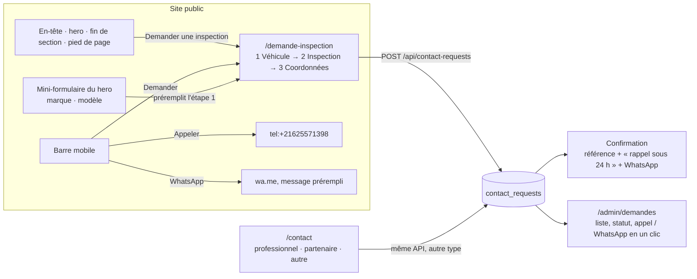
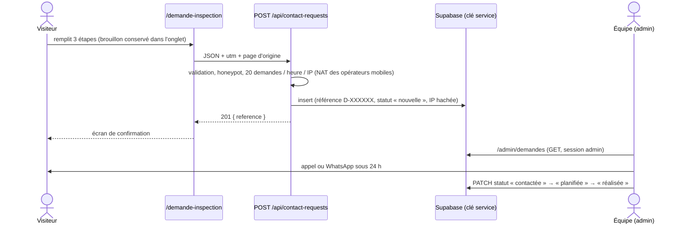

# Spec — CTA « Demander une inspection » et canaux de contact

Statut : **validée le 26 sept. 2026 (maquettes approuvées), implémentée sur feat/cta-demande-inspection** · 26 sept. 2026 · campagne commerciale à partir du 28 sept.

## 1. Objectif et décisions

Rendre la demande d'inspection évidente et sans perte : un seul appel à l'action répété partout,
un formulaire court qui **enregistre réellement** la demande (aujourd'hui le formulaire ouvre la
messagerie du visiteur via `mailto:` — une demande non envoyée est perdue sans que personne le
sache), et des canaux directs (téléphone, WhatsApp) visibles sur mobile.

Décisions du fondateur (26 sept. 2026) :

| # | Décision |
|---|---|
| 1 | Bouton WhatsApp autorisé (barre mobile, bloc contact). La règle « Pas de bouton CTA WhatsApp » de `docs/design-system/README.md` est levée pour ces emplacements ; le CTA principal reste le formulaire |
| 2 | ~~Aucun prix sur le site~~ — remplacée le 1–2 oct. 2026 par un tarif public, voir `docs/specs/2026-10-tarifs.md` |
| 3 | Engagement de réponse : **sous 24 h** |
| 4 | Demandes enregistrées en base, traitées depuis une page **/admin « Demandes »** (pas d'e-mail tant que Mailjet n'est pas validé) |
| 5 | En-tête : « Demander une inspection » (principal) **et** « Vérifier un certificat » (secondaire) |

Inspiré du benchmark (Trustoo, AutoJust, MonInspection, Carspector, Check den Wagen) : CTA unique
répété, véhicule d'abord et coordonnées en dernier, lien de l'annonce facultatif, barre mobile
appel + CTA, preuve sous le bouton. Écarté : notes d'avis et nombre de clients (inexistants à ce
jour), prix affiché, chat en direct.

## 2. Parcours





## 3. Emplacements et maquettes

### 3.1 En-tête

```
Desktop  [MALLOULIAUTO]  Accueil Technologie À propos Actualités Carrières Contact   Vérifier un certificat  [ Demander une inspection ]
Mobile   [MALLOULIAUTO]                                              [ Demander ]  [☰]
```
« Vérifier un certificat » reste un lien secondaire (desktop) et passe dans le menu sur mobile.

### 3.2 Hero

```
┌───────────────────────────────────────────────────────────────┐
│ (titre et texte actuels inchangés)                             │
│                                                               │
│ Marque [ Peugeot      ]  Modèle [ 208        ]  [ Demander une inspection → ] │
│ Inspecteur indépendant · 128 points · 14 instruments · rapport vérifiable en ligne │
│ Réponse sous 24 h · Voir un exemple de rapport ↓        Devenir partenaire │
└───────────────────────────────────────────────────────────────┘
```
Le mini-formulaire est facultatif : bouton cliquable champs vides ; les valeurs saisies
préremplissent l'étape 1.

### 3.3 Bandeau de fin de section — composant `InspectionCTA`

Après « Le rapport », « Ce que vous recevez », « Le parcours » et la FAQ (4 occurrences sur la
homepage), plus `/technology` et `/about`.
```
────────────────────────────────────────────────────────────────  (trait rule, pas de carte ni d'ombre)
Prêt à faire inspecter un véhicule ?              [ Demander une inspection → ]
Réponse sous 24 h · du lundi au samedi, 8 h – 18 h     ou  Appeler · WhatsApp
```

### 3.4 Barre mobile collante (< 1024 px, toutes les pages publiques sauf /demande-inspection)

```
┌──────────┬──────────┬──────────────────────────────┐
│ ☎ Appeler │ WhatsApp │   Demander une inspection    │
└──────────┴──────────┴──────────────────────────────┘
```
Fond blanc, trait `rule` en haut (la seule ombre du système reste celle de la navigation),
marge `safe-area` iOS. Le bouton du chat se décale au-dessus de la barre.

### 3.5 Page `/demande-inspection` (3 étapes, une question par groupe)

```
Demander une inspection                               Étape 1 sur 3 ━━━━━━━──────
Le véhicule
  Marque *        [            ]
  Modèle *        [            ]
  Année           [ ▾ ]
  Lien de l'annonce  [ https://www.tayara.tn/…      ]  (facultatif)
                                                   [ Continuer → ]

Étape 2 — L'inspection
  Objet *   (•) Achat / vente  ( ) Avant réparation … (les 7 objets du rapport)
  Lieu *    (•) Chez le vendeur  ( ) Chez moi  ( ) Dans vos locaux
  Ville *   [ Sfax        ]
  Date souhaitée  (•) Dès que possible  ( ) Une date précise [ jj/mm ]

Étape 3 — Vos coordonnées
  Nom *              [            ]
  Téléphone *        [ +216 __ ___ ___ ]
  Vous préférez      (•) Un appel  ( ) WhatsApp
  E-mail             [            ]  (facultatif)
  Précisions         [                        ]  (facultatif)
  [ ] J'ai lu et j'accepte la Politique de confidentialité… *
                                   [ ← Retour ]  [ Envoyer la demande ]
  Réponse sous 24 h. Aucun paiement à cette étape.
```
- Brouillon conservé en `sessionStorage` (retour arrière, rechargement).
- ~~Pas de case marketing ici~~ **Inversé le 30 sept. 2026** : Mailjet exige un formulaire avec une
  case marketing distincte, décochée par défaut. La case est à l'étape 3, sous celle de la
  politique de confidentialité ; elle impose une adresse e-mail et déclenche le double opt-in
  (`docs/marketing-consent.md`). `/contact` a la même case ; le formulaire newsletter du pied de page
  reste masqué tant que Mailjet n'est pas opérationnel.
- Accessibilité : un `fieldset`/`legend` par étape, erreurs en texte sous le champ, focus sur le
  premier champ en erreur.

### 3.6 Confirmation

```
Demande reçue — référence D-7K3F9Q
Nous vous rappelons sous 24 h, du lundi au samedi, 8 h – 18 h, au +216 •• ••• 398.
Plus rapide : écrivez-nous sur WhatsApp en indiquant votre référence.   [ WhatsApp ]
← Retour à l'accueil
```

### 3.7 Page `/contact`

Garde les canaux (téléphone, WhatsApp, e-mail, horaires) en tête. Le formulaire actuel
(`mailto:`) est remplacé par un envoi à la même API :
- « Particulier » → renvoie vers `/demande-inspection` ;
- « Professionnel », « Partenaire », « Autre » → formulaire court (nom, société, téléphone, e-mail,
  message) enregistré avec le type correspondant.

### 3.8 Admin — `/admin/demandes`

| Reçue | Réf. | Nom | Téléphone | Véhicule | Objet · lieu · ville | Canal | Statut | Note |
|---|---|---|---|---|---|---|---|---|
| il y a 2 h | D-7K3F9Q | … | ☎ · WhatsApp | Peugeot 208 2019 ↗annonce | Achat · chez le vendeur · Sfax | WhatsApp | [nouvelle ▾] | … |

- Filtres : statut, type. Tri par date, les plus anciennes « nouvelles » en premier.
- Badge **« > 24 h »** sur une demande encore « nouvelle » après 24 h.
- Statuts : `nouvelle` → `contactée` → `planifiée` → `réalisée`, ou `sans suite` / `annulée`.
- Compteur « Demandes à traiter » sur le tableau de bord admin.

## 4. Textes (FR, définitifs sauf remarque)

| Clé | Texte |
|---|---|
| CTA principal | Demander une inspection |
| CTA mobile court | Demander |
| Ligne de preuve | Inspecteur indépendant · 128 points · 14 instruments · rapport vérifiable en ligne |
| Engagement | Réponse sous 24 h, du lundi au samedi, 8 h – 18 h |
| Bandeau fin de section | Prêt à faire inspecter un véhicule ? |
| Message WhatsApp prérempli | Bonjour, je souhaite faire inspecter un véhicule. |
| Message WhatsApp (après envoi) | Bonjour, j'ai envoyé la demande {référence}. |
| Rassurance formulaire | Réponse sous 24 h. Aucun paiement à cette étape. |

« 128 points » et « 14 instruments » viennent de `src/data/inspectionFacts.js` (jamais écrits en
dur). Aucun prix, aucune note d'avis, aucun nombre de clients.

## 5. Données et API

Table `public.contact_requests` (nouvelle migration, RLS sans politique → clé service uniquement,
comme `agent_*`) :

| Colonne | Type | Remarque |
|---|---|---|
| `id` | uuid | |
| `reference` | text unique | `D-` + 6 caractères sans ambiguïté (pas de 0/O/1/I) |
| `kind` | text | `inspection` · `professionnel` · `partenaire` · `autre` |
| `status` | text | voir 3.8, défaut `nouvelle` |
| `full_name`, `phone` | text | obligatoires |
| `email`, `company`, `message` | text | facultatifs |
| `preferred_channel` | text | `appel` · `whatsapp` |
| `vehicle_make`, `vehicle_model`, `vehicle_year`, `listing_url` | | inspection uniquement |
| `purpose`, `location_type`, `city`, `preferred_date` | | inspection uniquement ; `purpose` ∈ objets du rapport |
| `page_url`, `utm` (jsonb), `referrer` | | mesure de la campagne, sans cookie |
| `ip_hash`, `user_agent` | | anti-abus (IP jamais stockée en clair) |
| `privacy_consent_version`, `privacy_consent_text` | | preuve d'acceptation |
| `internal_note`, `handled_by`, `status_changed_at`, `created_at`, `updated_at` | | suivi |

API (même modèle que `api/newsletter/*` et `api/agents/*`) :
- `POST /api/contact-requests` — public ; validation serveur, honeypot, 20 demandes / heure / IP (NAT des opérateurs mobiles) ;
  renvoie `{ reference }`.
- `GET` / `PATCH /api/admin/contact-requests` — admin (`server/adminAuth.js`) ; PATCH limité à
  `status` et `internal_note`.

Mesure : les paramètres `utm_*` de la page d'arrivée sont gardés dans l'onglet (`sessionStorage`)
et joints à la demande — on sait quelle annonce de la campagne produit des demandes, sans outil
d'analyse ni cookie.

## 6. Autres changements

- `docs/design-system/README.md` : règle WhatsApp mise à jour (décision 1).
- `src/pages/Privacy.jsx` : section « Demandes d'inspection et de contact » (finalité, durée de
  conservation — voir question 3).
- `CertificationFlow` étape 1 : « Vous nous indiquez le véhicule et le lieu — en ligne, par
  WhatsApp ou par téléphone. »
- Pendant la campagne, deux interrupteurs (variables `VITE_CHAT_ENABLED`, `VITE_NEWSLETTER_ENABLED`)
  pour masquer le chat tant qu'il n'y a pas de crédits Anthropic, et la newsletter tant que
  Mailjet n'est pas validé.

## 7. Tests

- API : validation, honeypot, limite de débit, accès admin (sans session / non-admin / admin).
- Migration : base vierge et rejeu, deux fois ; accès `anon` refusé.
- Navigateur : parcours complet sur mobile (375 px) et desktop, préremplissage depuis le hero,
  brouillon conservé, confirmation, visibilité de la barre mobile, pas de chevauchement avec le
  chat, clavier et lecteur d'écran sur le formulaire.
- Local (`vercel dev` + `supabase start`), puis preview Vercel avant fusion.

## 8. Questions ouvertes

1. Numéro WhatsApp : **+216 25 571 398** (le même que le téléphone) ?
2. Horaires affichés : **lundi – samedi, 8 h – 18 h** (ceux de `/contact`) ? Les 24 h courent-elles
   le dimanche ?
3. Durée de conservation des demandes sans suite : proposition **24 mois** après le dernier échange.
4. Interrupteurs chat / newsletter : les activer pour la campagne ?
