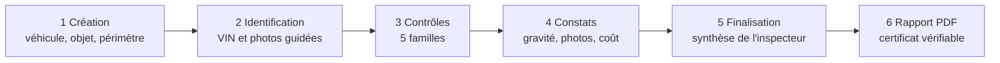

# Spec — Guide « Notre protocole d'inspection » (guide n° 4)

Statut : **validée le 3 oct. 2026, implémentée sur `feat/guide-protocole`** — guide livré en brouillon (migration `20261003130100_guide_protocole_draft.sql`), images des instruments à ajouter par l'éditeur

Sources : dépôt produit `C:\Work\malloulinova\mallouliauto` (fait foi pour les faits produit), lu en lecture seule le 3 oct. 2026 ; `src/data/inspectionFacts.js` ; `docs/specs/2026-10-guides.md`. Les valeurs marquées « vérifié » ont été recomptées en exécutant la taxonomie (`ELEMENTS`, `GRAVITE_LEVELS`, `MATERIEL_CATALOGUE`).

## 1. Objectif et public

Une **courte introduction** à la méthode, de la création de l'inspection à la génération du rapport : ce qui est contrôlé, comment, avec quels instruments. Lecture visée : 5 à 6 minutes. Public premier : un **partenaire ou inspecteur potentiel** (page `/contact?type=partenaire`), second public : un acheteur ou un professionnel qui veut comprendre ce que contient un rapport.

Ce n'est ni un manuel d'inspection ni la liste des points de contrôle : on décrit la structure, pas les procédures.

| # | Décision proposée | À valider |
|---|---|---|
| 1 | Publier comme **guide n° 4** dans `/guides`, avec une nouvelle catégorie **« Protocole »** | oui / autre |
| 2 | Titre : « Notre protocole d'inspection, de la demande au rapport » ; slug `protocole-inspection-mallouliauto` | oui / autre |
| 3 | Niveau de détail : 5 familles, les instruments, la structure du rapport ; **ni les 131 points un par un, ni les pas à pas des procédures** | oui |
| 4 | Images : photos **réelles** des instruments MALLOULIAUTO, une par instrument, présentées en grille | voir §5 |
| 5 | Appel à l'action de fin de guide : **« Devenir partenaire »** (`/contact?type=partenaire`), à côté de « Demander une inspection » | oui |
| 6 | Corriger avant publication les faits périmés du site (§4) | fait le 3 oct. 2026 (§4) |

Remarque de fond : publier la méthode donne un modèle à copier. Le risque est faible et assumé : le positionnement (dataroom) est de **standardiser et rendre vérifiable**, pas de garder la méthode secrète, et la valeur est dans les instruments, les inspecteurs habilités et le rapport vérifiable. La limite posée par la décision 3 (structure, pas procédures) sert à la garder raisonnable.

## 2. Parcours décrit dans le guide

Les libellés viennent du produit (statuts : `Brouillon`, `En cours`, `Rapport généré`). **L'ordre exact des familles n'est pas affirmé** : le code de l'application et les commentaires de la taxonomie divergent (le diagnostic électronique est annoncé en premier dans la taxonomie, en troisième dans l'assistant). Le guide dit « les familles contrôlées » sans numéroter leur ordre tant que le fondateur n'a pas tranché.

## 3. Plan et contenu du guide

Faits tirés du produit. Rien n'est ajouté qui ne soit pas dans le code ; chaque ligne porte son statut.

### 3.1 En bref
Qui inspecte (un inspecteur habilité, sur tablette ou téléphone), ce qui sort (un rapport PDF avec certificat vérifiable en ligne), et ce que le protocole ne fait pas (§3.8).

### 3.2 Étape 1 — Création de l'inspection
Saisie : identité du véhicule (numéro de châssis, marque, modèle, année, plaque, énergie, boîte, puissance, couleur), coordonnées du client, lieu, **objet** et **périmètre**.
- Objets : `Achat / Vente`, `Avant réparation`, `Après réparation`, `Préventive`, `Visite technique`, `Après accident / Expertise`.
- Périmètres : une famille, `Complet` ou `Personnalisé`.
- Niveau de démontage : `Aucun démontage`, `Démontage partiel`, `Démontage complet`.
- Chiffrage des réparations : **facultatif**, `Approximatif` ou `Précis`.

### 3.3 Étape 2 — Identification
Numéro de châssis et **13 photos guidées** (quatre coins, faces avant et arrière, côtés gauche et droit, pare-brise, sièges avant et tableau de bord, sièges arrière, plaque du numéro de châssis, compteur).

### 3.4 Étape 3 — Contrôles par famille
Cinq familles et vingt et une sous-familles. **Tableau du guide** (une ligne par famille). Les instruments viennent de la liste du matériel réel (§5). Tous sont utilisés à chaque inspection complète (confirmé par le fondateur le 3 oct. 2026) ; les instruments propres à un carburant (compressiomètre essence ou diesel, analyseur de gaz pour l'essence, opacimètre pour le diesel) suivent la motorisation du véhicule.

| Famille | Ce qui est contrôlé | Comment | Instruments |
| --- | --- | --- | --- |
| Diagnostic électronique | Cohérence kilométrique entre calculateurs, codes défaut, voyants et système électronique | Lecture des calculateurs, mesure électrique | Appareil de diagnostic, oscilloscope, multimètre |
| Niveaux, liquides et batterie | Six liquides (huile, refroidissement, lave-glace, frein, direction assistée, boîte automatique) et la batterie | Contrôle visuel, mesure | Testeur de liquide de frein, testeur de qualité d'huile moteur, testeur de circuit de refroidissement, testeur de batterie et de système de charge |
| Motopropulseur | Moteur, transmission, train roulant (pneus, direction, suspension, freins) | Contrôle visuel, essai fonctionnel et dynamique, mesure | Stéthoscope mécanique, jauge d'usure des pneus, pompe à vide, kit de mesure de pression d'huile, compressiomètre (essence ou diesel), analyseur de gaz (essence) ou opacimètre (diesel) |
| Enveloppe extérieure | Châssis, carrosserie et tôlerie, vitrage | Contrôle visuel en lumière rasante, mesure de l'épaisseur de peinture | Détecteur d'épaisseur de peinture, caméra d'inspection |
| Confort et sécurité | Éclairage, climatisation, airbags, ceintures, rétroviseurs, essuie-glaces, équipements intérieurs, accès et démarrage | Contrôle visuel, essai fonctionnel | Testeur de qualité de froid de climatisation, appareil de diagnostic |

Équipements cités dans le texte, sans être comptés comme instruments : élévateur de voiture amovible, bloc volant (immobilise le volant pendant le contrôle de la direction), torche, caisse à outils.

Le nombre de points : **131 éléments** au périmètre complet (vérifié le 3 oct. 2026 ; les six liquides sont une liste à part et ne sont pas comptés). C'est désormais le chiffre du site (§4).

Trois précisions utiles à un partenaire, toutes vérifiées dans le code :
- **Les pneus** : la conclusion d'usure suit une règle fixe (moins de 1,6 mm : non conforme ; de 1,6 à moins de 3 mm : usure avancée ; de 3 à moins de 5 mm : état moyen ; 5 mm et plus : bon état).
- **La peinture et la climatisation** : la conclusion reste **le jugement de l'inspecteur**, pas un seuil automatique (décision produit : un seuil automatique était « trop peu fiable pour être énoncé comme un fait »).
- **Chaque mesure est rattachée à l'instrument qui l'a produite** et horodatée.

### 3.5 Étape 4 — Constats
Pour chaque défaut : une description, une **gravité** (`Mineure`, `Modérée`, `Majeure`), des photos et, si activé, un chiffrage (réparation ou remplacement, pièces, main-d'œuvre, matériel, en dinars). Chaque information porte sa provenance : `mesuré`, `observé`, `calculé`, `estimation d'expert`, `non évalué`. L'absence de défaut est notée (`rien à signaler` ou `non équipé`).

### 3.6 Étape 5 — Finalisation
Obligatoires avant la génération : le contexte de l'inspection, la **synthèse de l'inspecteur** (texte écrit par la personne, jamais calculé) et une gravité sur chaque constat. Une fois finalisée, **une inspection ne peut plus être modifiée ni supprimée**.

### 3.7 Étape 6 — Rapport et certificat
Rapport PDF : identité du véhicule, photos d'identification, constats par famille classés par gravité, mesures, total estimé des réparations (si activé), synthèse de l'inspecteur, traçabilité (organisme, opérateur, date, lieu, matériel). Le certificat porte un **numéro** et un **QR code** ; la page publique de vérification indique si le certificat est valide, révoqué ou introuvable, et affiche l'**empreinte SHA-256** du document pour détecter toute modification.

### 3.8 Ce que le protocole ne fait pas
Le rapport ne contient **ni note globale, ni recommandation d'achat, ni garantie sur la structure du véhicule**. Il indique en revanche le prix le plus probable du véhicule, une estimation du marché et non un prix garanti (décision produit du 5 oct. 2026, ma-inspector #317 ; migration `20261017100000_valuation_copy.sql`). Le guide l'énonce sans détour : c'est un argument de confiance.

### 3.9 Matériel
Grille d'instruments (§5), puis appel à l'action partenaire.

## 4. Chiffres du site — corrigés le 3 oct. 2026

Corrigés sur la branche `docs/guide-protocole-spec`, avant le guide, à la demande du fondateur. Source unique : `src/data/inspectionFacts.js`, recalculé en exécutant la taxonomie du produit.

| Fait | Avant | Maintenant |
| --- | --- | --- |
| Points (périmètre complet) | 128 | **131** |
| Sous-familles | 20 (« Accès, démarrage et antivol » manquante) | **21** |
| Niveaux de gravité | 4, dont « Critique » | **3** : Mineure, Modérée, Majeure |
| Instruments | 14 (catalogue produit + jauge de peinture, dont tablette et connexion internet) | **18 instruments de contrôle** (liste du fondateur, multimètre compris) + 5 équipements cités, non comptés (chariot garagiste ajouté le 3 oct.) |

Fichiers touchés : `inspectionFacts.js`, `Services.jsx` (128 écrit en dur), `ReportShowcase.jsx`, `CertificateVisual.jsx`, `CoverageChecklist.jsx` (liste d'instruments, équipements, intitulé), `HeroCertification.jsx` (« instruments de contrôle »), `platformCapabilities.js` et `Technology.jsx` (« 4 niveaux » écrit en dur), le prompt marketing et son miroir, `docs/design-system/README.md`, et la base de connaissance des agents (migration `20261003120000_agent_knowledge_severity_three_levels.sql`, catégorie `proof`, miroir `server/agents/shared/knowledge/proof.md`). Le chatbot lit déjà `inspectionFacts.js`.

Non modifié : la gravité « Critique » de la carte du module de vision (`VisionModule.jsx`) appartient à l'échelle propre du prototype (critique, élevé, moyen, faible), affichée hors rapport ; seul son commentaire est corrigé.

Écart restant côté produit : `MATERIEL_CATALOGUE` (13 entrées, liste « Matériel utilisé » du rapport) ne correspond pas à la liste réelle. Le site ne dit donc plus « nommé dans chaque rapport » pour la liste entière, mais « chaque rapport nomme le matériel réellement utilisé ».

## 5. Matériel et images

### 5.1 Liste du matériel (fondateur, 3 oct. 2026)

**Instruments de contrôle (18)** : appareil de diagnostic, oscilloscope, multimètre, détecteur d'épaisseur de peinture, jauge d'usure des pneus, testeur de batterie et de système de charge, testeur de liquide de frein, testeur de qualité d'huile moteur, kit de mesure de pression d'huile, testeur de circuit de refroidissement (radiateur), testeur de qualité de froid de climatisation, compressiomètre essence, compressiomètre diesel, analyseur de gaz, opacimètre, stéthoscope mécanique, pompe à vide, caméra d'inspection (écran TFT/LCD).

**Équipements (5)** : élévateur de voiture amovible, bloc volant (immobilise le volant pendant le contrôle de la direction), torche, caisse à outils, chariot garagiste (ajouté le 3 oct. 2026).

Le site compte les 18 instruments et cite les 5 équipements. Choix fait pour que « instruments de contrôle » reste exact : une caisse à outils ou une torche ne mesurent rien. Si le fondateur préfère afficher 21, une ligne suffit (`TOTAL_INSTRUMENTS` dans `inspectionFacts.js`) avec l'intitulé « instruments et équipements ».

### 5.2 Images

Décision du fondateur : images **trouvées sur le web ou générées** (ChatGPT). Règles proposées :

- **Images du web : seulement sous licence qui autorise la réutilisation commerciale** (Wikimedia Commons sous CC BY ou CC BY-SA avec crédit, Unsplash, Pexels), jamais une photo de fabricant ou de boutique en ligne copiée : c'est une œuvre protégée, et elle montre une marque et un modèle que nous n'avons peut-être pas. Le crédit exigé par la licence figure sous la grille.
- **Images générées** : appareil générique, **sans marque, sans texte ni chiffre lisible à l'écran**, sur fond gris clair uni, cadrage carré, même lumière pour toute la série (même méthode que `docs/prompt-guides-covers.md`). Chaque image doit ressembler à notre appareil réel : un partenaire peut y lire une promesse de matériel.
- **Préférer une même source pour toute la grille** (toutes générées, par exemple) : une grille mêlant photos de catalogue et rendus générés paraît bricolée.
- Écart assumé avec `docs/design-system/README.md` (imagerie réelle uniquement), comme pour les couvertures : illustrations provisoires, à remplacer par des photos de notre matériel.
- Export carré, 800 à 1 200 px, WebP, **moins de 5 Mo** (viser 200 Ko). Texte alternatif = nom de l'instrument.

Si des images manquent le jour de la publication, le guide paraît sans grille ; aucune image n'est un prérequis.

## 6. Conception technique

Réutilisation maximale de ce qui existe :

| Besoin | Solution | Coût |
| --- | --- | --- |
| Catégorie « Protocole » | Valeur `protocole` ajoutée à la contrainte `guides_category_check` (nouvelle migration) et à `GUIDE_CATEGORIES` (`src/data/guides.js`) | faible |
| Images dans le corps du guide | Le bouton « image » de l'éditeur Markdown envoie le fichier dans le bucket `guides` (chemin `body/<uuid>.<ext>`) par `uploadGuideCover`, généralisée en `uploadGuideImage` ; l'URL est insérée en ``. Mêmes contrôles : JPEG, PNG, WebP, 5 Mo | moyen |
| Grille d'instruments | **Sans nouveau composant** : une liste Markdown dont chaque élément contient une image (`-  **Nom** : usage`), mise en grille par CSS (`.guide-body ul:has(img)`), cartes à bordure fine, sans ombre, cohérentes avec `GuideCard` | faible |
| Images du corps | Style `.guide-body img` : largeur maximale, bordure `rule`, `loading="lazy"`, dimensions réservées pour éviter les sauts de mise en page | faible |
| Tableau des familles | Tableau Markdown déjà pris en charge et stylé (`.guide-body table`) | nul |
| Brouillon du guide | Migration `…_guide_protocole_draft.sql`, en `draft`, sans images ; le fondateur relit, publie, puis ajoute les photos par l'éditeur | faible |
| Appel à l'action partenaire | Variante de `InspectionCTA` ou second bouton sur la page du guide quand la catégorie est `protocole` | faible |

Aucune nouvelle dépendance. L'éditeur Markdown (EasyMDE) vient d'un CDN ; l'option d'envoi d'image est native (`uploadImage`, `imageUploadFunction`).

Sécurité : seuls les administrateurs écrivent dans le bucket ; le rendu Markdown échappe déjà le HTML avant l'analyse ; l'URL d'image est celle du bucket (pas de saisie libre exigée). Pas de nouvelle donnée personnelle.

## 7. Règles de revendication (à relire par le fondateur)

| Ce qu'on peut dire (vérifié dans le produit) | Ce qu'on ne dit pas |
| --- | --- |
| Trois niveaux de gravité ; constat daté, mesuré, rattaché à un instrument | Un niveau « Critique », une note globale, une classe A à F ; un instrument propre à un carburant présenté comme utilisé sur tous les véhicules |
| Une inspection finalisée ne peut plus être modifiée | « Le PDF est signé numériquement » : le code ne contient qu'une **empreinte SHA-256** et une chaîne de hachage, pas de signature cryptographique |
| Le certificat se vérifie en ligne (valide, révoqué, introuvable) ; empreinte affichée | Un processus de révocation exposé aux clients : la base et la page le prévoient, aucun parcours n'est branché dans l'application |
| La synthèse est rédigée par l'inspecteur | Un contenu de synthèse produit par une IA |
| Les photos sont téléversées avec une file de reprise | « Fonctionne hors ligne » : non vérifié |
| 131 points de contrôle au périmètre complet | Un ordre strict des familles ; « audité » ou « éprouvé en production » (société pré-commerciale) |
| Rapport sans recommandation d'achat ni garantie sur la structure | Le texte de limite exact comme « imprimé dans le PDF » : il est dans la synthèse détaillée, **non confirmé dans le PDF** |

Autres points à garder en tête : devise en **dinars tunisiens** uniquement ; le module de vision par ordinateur reste hors rapport, comme sur `/technology`, et n'est pas mentionné comme une étape du protocole ; la disposition et la pagination du PDF n'ont pas été confirmées visuellement dans la documentation produit : le guide décrit le contenu, pas la mise en page.

## 8. Risques

- **Chiffres** (§4) : corrigés ; reste à réaligner le catalogue produit.
- **Promesse de matériel** : image d'un appareil qui ne ressemble pas au nôtre. Atténué par §5.
- **Droits d'auteur** : image du web sans licence de réutilisation. Atténué par §5.2.
- **Trop de détail** : un guide de 131 points devient illisible et copiable. Atténué par la décision 3.
- **Mélange des publics** : acheteurs et partenaires sur la même page « Guides ». Atténué par la catégorie « Protocole » et, si besoin plus tard, un filtre ou un lien d'en-tête séparé.
- **Dérive** : le produit évolue vite (la gravité « Critique » a disparu en septembre). Le guide porte une date « Relu le » et une **relecture à chaque changement de taxonomie**.

## 9. Plan de test

- Vérification manuelle sur l'aperçu : liste Markdown à images rendue en grille (mobile et bureau), image absente ou lente, texte alternatif, tableau des familles, brouillon invisible aux visiteurs, envoi d'image depuis l'éditeur (type et taille refusés).
- Contrôle croisé de chaque chiffre du guide contre la taxonomie du produit (script déjà utilisé le 3 oct. : `ELEMENTS`, `GRAVITE_LEVELS`, `MATERIEL_CATALOGUE`).
- `npm run lint` et build ; pas de cadre de test automatisé dans le dépôt.

## 10. Décisions du fondateur (3 oct. 2026)

| # | Question | Réponse |
| --- | --- | --- |
| 1 | Titre, slug, catégorie « Protocole » | Validés |
| 2 | Ordre des familles | Non tranché : le guide ne numérote pas les familles |
| 3 | Multimètre | Oubli de la liste : ajouté (n° 14), 18 instruments |
| 4 | Bloc volant | Immobilise le volant pendant le contrôle de la direction ; reste un équipement |
| 5 | Compressiomètres, analyseur de gaz, opacimètre, oscilloscope, kit de pression d'huile | Utilisés à chaque inspection complète (selon le carburant pour les instruments qui en dépendent) |
| 6 | Chiffrage des réparations | Mentionné publiquement comme option du protocole, en dinars |
| 7 | 17 / 18 ou 21 | Instruments comptés, équipements cités à part |
