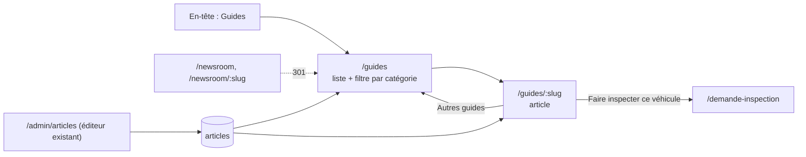

# Spec — « Actualités » devient « Guides »

Statut : **validée le 2 oct. 2026, implémentée sur feat/guides-page (non fusionnée)**

Réponses du fondateur (2 oct. 2026) : libellé « Guides » ; les trois premiers guides sont ajoutés tout de suite, relus par le fondateur le jour même (le lien reste donc dans l'en-tête, sans indicateur) ; anciennes visites `/newsroom*` regroupées avec `/guides*`.

Nommage (demande du fondateur, 2 oct.) : plus aucun « newsroom » ni « article » dans le code. La table `articles` devient `guides` (migration `20261002140000_articles_renamed_guides.sql`, qui renomme aussi ses politiques et contraintes), `articleService` devient `guideService`, l'éditeur passe de `/admin/articles` à `/admin/guides`. Les seules occurrences restantes de `/newsroom` sont les redirections 301 de `vercel.json` et la réécriture des anciennes visites, nécessaires pour ne pas casser les liens existants. Les sections ci-dessous gardent les noms d'origine (`articles`, `NewsRoom.jsx`…) comme historique de la proposition.

Écarts par rapport à la proposition : (1) les trois guides sont livrés en **brouillon** par la migration `20261002130100_guides_first_drafts.sql` et publiés depuis `/admin/articles` après relecture ; (2) l'éditeur gagne un champ **Statut** et un champ **Résumé** (sinon le résumé rédigé était écrasé par les 140 premiers caractères du texte) ; (3) un administrateur peut prévisualiser un brouillon sur `/guides/:slug` (page non indexée) ; (4) le regroupement des visites se fait par réécriture des chemins dans `page_views` (migration `20261002130000_articles_guides_fields.sql`) ; (5) pas de tests automatisés : le dépôt n'a pas de cadre de test, la vérification s'est faite sur la base Supabase locale.

## 1. Objectif et décisions proposées

La page « Actualités » (`/newsroom`) promet un rythme de publication qu'une entreprise pré-commerciale ne peut pas tenir, et reste vide (`src/data/newsData.js`). Elle devient **« Guides »** : des articles pédagogiques intemporels (comment contrôler des pneus, repérer une peinture refaite…) qui répondent aux recherches des acheteurs, appuient le positionnement de certificateur indépendant et mènent vers la demande d'inspection.

| # | Décision proposée | À valider |
|---|---|---|
| 1 | Libellé de l'en-tête et titre de page : **« Guides »** | oui / autre libellé |
| 2 | URL : **`/guides`** et **`/guides/:slug`** ; `/newsroom` et `/newsroom/:slug` redirigent en 301 | oui |
| 3 | Pas de section « actualités » conservée : les nouveautés produit vont dans la newsletter et sur l'accueil | oui |
| 4 | Chaque guide affiche une **catégorie**, un **temps de lecture** et une date **« Relu le »** (au lieu d'une date de publication d'actualité) | oui |
| 5 | Chaque guide se termine par un encart « Faire inspecter ce véhicule » vers `/demande-inspection` | oui |
| 6 | Lancement avec 4 à 6 guides relus par un inspecteur, pas davantage | oui |

## 2. Ce qui existe déjà (vérifié dans le dépôt)

- Table `articles` (`title, body, excerpt, cover_image_url, slug, author, status, published_at`) ; lecture publique des articles publiés, écriture réservée aux admins (`20260925100400_harden_rls.sql`).
- `NewsRoom.jsx` sert à la fois la page publique (`/newsroom`) et l'éditeur admin (`/admin/articles`). `NewsArticle.jsx` rend le corps en Markdown échappé, avec JSON-LD et fil d'Ariane.
- `newsData.js` : liste de repli vide, volontairement (pas de contenu inventé).
- Références à mettre à jour : `Navigation.jsx:24`, `App.jsx:105-106`, `trackedPaths.js` (page `/newsroom` et motif `ARTICLE`), `public/sitemap.xml`, `articleService.js` (`url`), `newsData.js` (`url`), `Login.jsx`, `Footer.jsx:171`.

Conséquence : pas de nouveau système de contenu. On garde la table et l'éditeur ; on ajoute deux colonnes et on renomme.

## 3. Architecture



### 3.1 Données

Migration `supabase/migrations/2026100x…_articles_guides_fields.sql`, idempotente :

| Colonne | Type | Rôle |
|---|---|---|
| `category` | `text` avec contrainte `check` sur la liste fermée ci-dessous | filtre et étiquette |
| `reviewed_at` | `date` | « Relu le … » ; renseignée par l'admin à chaque relecture |

Catégories (liste fermée) : `carrosserie`, `pneus-freins`, `mecanique`, `documents`, `diagnostic`.
Le temps de lecture est calculé à l'affichage (mots ÷ 200), pas stocké. Les articles existants (aucun publié à ce jour) auraient `category` nulle, affichée sans étiquette.

Les RLS existantes couvrent les nouvelles colonnes : aucune policy à modifier.

### 3.2 Routes et redirections

- `App.jsx` : routes `guides` et `guides/:slug` ; les routes `newsroom` sont retirées.
- `vercel.json` : `/newsroom` → `/guides` et `/newsroom/:slug` → `/guides/:slug`, `permanent: true`. Le rewrite vers `index.html` ne gérant pas les redirections côté client, la redirection côté Vercel est nécessaire pour les liens déjà indexés ou partagés.
- `trackedPaths.js` : `/newsroom` → `/guides` et motif `ARTICLE` → `/guides/…`. Sans cela les vues sont silencieusement ignorées (voir le commentaire du fichier). Les anciennes visites `/newsroom*` déjà enregistrées restent en base ; le tableau de bord admin doit les regrouper avec `/guides*` ou afficher les deux (à vérifier dans `admin` avant de coder).
- `sitemap.xml` : `/guides` ; les URL des guides sont ajoutées à la publication.
- Le chemin `/admin/articles` ne change pas ; seul son libellé admin devient « Guides ».

## 4. Maquettes

### 4.1 Liste `/guides`

```
┌──────────────────────────────────────────────────────────────┐
│ Guides                                                        │
│ Apprenez à repérer les défauts d'une voiture d'occasion avant │
│ d'acheter. Ces contrôles aident à choisir ; ils ne remplacent │
│ pas une inspection complète.                                  │
│                                                              │
│ [Tous] [Carrosserie] [Pneus et freins] [Mécanique] [Documents] [Diagnostic] │
│                                                              │
│ ┌──────────────┐ ┌──────────────┐ ┌──────────────┐           │
│ │ [Photo à venir] │ [Photo à venir] │ [Photo à venir] │      │
│ │ CARROSSERIE · 6 min │ PNEUS · 4 min │ …                    │
│ │ Reconnaître une peinture refaite │ …                       │
│ │ Relu le 2 oct. 2026 │                                       │
│ │ [ Lire le guide ]                                          │
│ └──────────────┘ └──────────────┘ └──────────────┘           │
│                                                              │
│ ┌──────────────────────────────────────────────────────────┐ │
│ │ Vous préférez confier le contrôle à un professionnel ?    │ │
│ │ [ Demander une inspection ]   À partir de 250 TND TTC     │ │
│ └──────────────────────────────────────────────────────────┘ │
└──────────────────────────────────────────────────────────────┘
```

État vide (avant le premier guide publié) : « Les premiers guides arrivent bientôt. » + bouton « Demander une inspection ». Pas de carte factice. Les cartes réutilisent `NewsCard` (renommée `GuideCard`) et le motif `Slot` « Photo à venir » ; aucune photo de banque d'images.

### 4.2 Guide `/guides/:slug`

```
Accueil › Guides › Carrosserie
CARROSSERIE · 6 min de lecture · Relu le 2 oct. 2026
# Reconnaître une peinture refaite
(chapô)
## Ce que vous pouvez contrôler vous-même
## Ce qu'un contrôle visuel ne permet pas de conclure
## Quand demander une inspection
┌──────────────────────────────────────────────────────────┐
│ Faire inspecter ce véhicule — rapport vérifiable en ligne │
│ [ Demander une inspection ]                               │
└──────────────────────────────────────────────────────────┘
Autres guides : 3 cartes de la même catégorie, sinon les plus récents
```

JSON-LD : `Article` (`datePublished`, `dateModified` = `reviewed_at`) + `BreadcrumbList`. Le Markdown actuel est conservé (déjà échappé avant rendu).

## 5. Règles éditoriales

Elles découlent des règles de revendication de la dataroom et de `docs/design-system/README.md`.

1. **Observé / inféré / à vérifier** : un guide distingue ce que l'on voit, ce que cela peut signifier et ce qu'il reste à contrôler. Pas de conclusion de panne à partir d'un seul indice (ex. un écart d'épaisseur de peinture ne prouve pas un accident).
2. **Aide à la décision, pas substitut** : chaque guide rappelle ses limites et renvoie à l'inspection complète. Aucune promesse du type « vous détecterez tout ».
3. **Aucun prix** dans les guides, hors renvoi vers `/tarifs` et l'encart « à partir de 250 TND TTC » lu depuis `src/data/pricing.js`.
4. **Pas de chiffres inventés** (seuils, pourcentages, statistiques du marché tunisien) sans source citée dans le guide. Les seuils techniques (profondeur de gomme, épaisseur de peinture) sont validés par un inspecteur.
5. **Relecture** : un guide n'est publié (`status = published`) qu'avec `reviewed_at` renseignée. Le champ est vérifié par l'éditeur admin.
6. **Aucune photo de banque d'images** ; photos réelles d'inspection uniquement, sinon « Photo à venir ».
7. Pas de mention de NOVA : AUTO reste séparé (décision du 24 sept.).

### Premiers guides proposés (plan, à valider)

| # | Catégorie | Guide | Lien vers l'inspection |
|---|---|---|---|
| 1 | Pneus et freins | Contrôler l'état des pneus avant d'acheter | usure, âge (code DOT), usure irrégulière = piste d'alignement ou de suspension |
| 2 | Carrosserie | Reconnaître une peinture refaite | différences de teinte, jeux de panneaux, joints ; limites du contrôle visuel |
| 3 | Carrosserie | Repérer les signes d'un accident | longerons, soudures, plis, airbags |
| 4 | Documents | Vérifier les papiers d'une voiture d'occasion | carte grise, numéro de châssis, cohérence de l'annonce |
| 5 | Diagnostic | Ce que dit (et ne dit pas) un voyant moteur | un code défaut ne désigne pas la pièce défaillante |
| 6 | Mécanique | Essai routier : quoi observer | bruits, comportement, fumées |

Les points 1 à 4 reprennent des pratiques courantes ; le contenu détaillé et les seuils sont à fournir ou valider par l'équipe inspection avant rédaction. Je peux rédiger les brouillons, mais pas les valider techniquement.

## 6. Autres modifications de texte

| Emplacement | Changement |
|---|---|
| `Navigation.jsx` | `{ path: '/guides', label: 'Guides' }` |
| `Footer.jsx:171` | « Recevez nos actualités sur la certification… » → « Recevez nos guides et nos conseils sur l'achat d'un véhicule d'occasion. » (formulaire actuellement masqué) |
| `consentPolicy.js` | **Inchangé.** Le texte de consentement (« actualités, offres et informations commerciales ») est un texte juridique rattaché aux consentements déjà enregistrés ; le modifier impose de versionner la politique de consentement (`marketing-consent.md`). À traiter à part si souhaité |
| `Privacy.jsx` | Vérifier la mention « actualités » ; ne pas la changer sans la même vérification juridique |
| `server/agents/sales/enrichment.ts` | Vérifier la mention (probablement sans lien avec la page) |
| `NewsRoom.jsx` / `NewsArticle.jsx` / `NewsCard.jsx` | Renommés `Guides.jsx` / `Guide.jsx` / `GuideCard.jsx` ; l'éditeur admin garde sa logique, avec les champs Catégorie et Relu le |
| Admin | Menu « Articles » → « Guides » |

## 7. Risques et points de vigilance

- **Contenu technique erroné** : le principal risque. D'où la règle 5 et la relecture par un inspecteur.
- **SEO** : la redirection 301 doit exister avant la mise en ligne ; un `newsroom` sans redirection casserait les liens externes.
- **Mesure des visites** : voir §3.2 (suivi des chemins).
- **Article sans catégorie** : doit s'afficher correctement (étiquette absente, visible sous « Tous »).
- **Aucun guide publié** : l'état vide doit être propre ; ne pas lancer le lien dans l'en-tête avec une page vide si les premiers guides ne sont pas prêts (voir question 2).

## 8. Plan de test

- Tests unitaires : `trackedPath` (`/guides`, `/guides/slug`, `/newsroom` ignoré), calcul du temps de lecture, filtre par catégorie.
- Vérification manuelle sur l'aperçu : redirections `/newsroom*`, état vide, guide avec et sans catégorie, rendu mobile, JSON-LD, éditeur admin (création, relecture, publication).
- `npm run lint` et build.

## 9. Questions ouvertes

1. Libellé final : « Guides » ou « Guides & conseils » ?
2. Publier le lien « Guides » dans l'en-tête dès maintenant (page à l'état vide) ou seulement quand 3 guides au moins sont prêts ? **Recommandation : attendre 3 guides**, en déployant le code mais en laissant le lien masqué par un indicateur dans `src/lib/features.js`.
3. Qui relit techniquement les guides, et quelle est la date cible du premier lot ?
4. Faut-il regrouper les anciennes visites `/newsroom*` avec `/guides*` dans le tableau de bord admin ?

## 10. Images de couverture (3 oct. 2026)

Bouton « Téléverser une image » dans l'éditeur : le fichier va dans le bucket Storage public `guides` (migration `20261003100000_guides_cover_storage.sql`), et son URL publique est enregistrée dans `cover_image_url`. Limites imposées par le bucket : 5 Mo (2 Mo à l'origine, relevée par la migration `20261003110000_guides_cover_limit_5mb.sql`), JPEG, PNG ou WebP. Seuls les administrateurs peuvent écrire (`is_homepage_admin()`). Le nom d'origine du fichier n'est jamais réutilisé (UUID). Un chemin du site (`/images/...`) reste accepté dans le champ ; les métadonnées Open Graph le convertissent en URL absolue.
