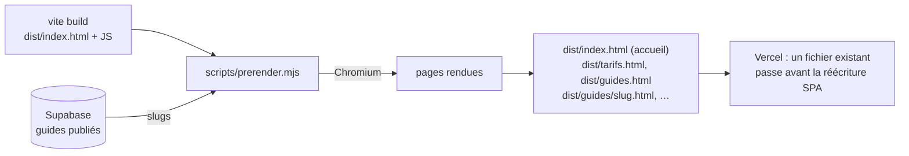

# Spec — Pré-rendu des pages publiques

Statut : **validée le 3 oct. 2026 (option A, crochet de déploiement, sitemap généré, repli sans échec), implémentée sur `feat/prerendering`**

## 1. Problème

Le site est une application React rendue dans le navigateur : le serveur envoie le même `index.html` pour toutes les adresses. Google exécute le JavaScript et lit donc le bon titre et la bonne description de chaque page. Mais les **aperçus de lien** (WhatsApp, Facebook, LinkedIn, X) n'exécutent pas le JavaScript : un lien vers `/tarifs` ou vers un guide affiche le titre, la description et l'image de l'accueil. Les robots qui n'exécutent pas le JavaScript (Bing en partie, la plupart des outils SEO) ne voient aucun contenu.

Objectif : chaque page publique est servie avec **son propre HTML** : en-tête (titre, description, image de partage, données structurées) et contenu.

## 2. Options

| Option | Principe | Pour | Contre |
| --- | --- | --- | --- |
| **A. Pré-rendu au build par navigateur sans interface (recommandé)** | Après `vite build`, un script ouvre chaque page publique dans Chromium, attend le rendu, et enregistre le HTML obtenu (`dist/tarifs.html`, `dist/guides/<slug>.html`…) | Aucun changement de l'application ; titres et descriptions restent écrits une seule fois (`SEO.jsx`) ; contenu complet pour les robots | Allonge le build (~1 min) ; Chromium au build ; un guide publié après le déploiement n'est pré-rendu qu'au déploiement suivant |
| B. En-tête injecté à la demande (fonction Vercel) | Une fonction réécrit `index.html` avec le bon en-tête à chaque requête | Toujours à jour | Duplique les titres et descriptions hors de `SEO.jsx` ; une fonction sur chaque page vue (latence, démarrage à froid) ; pas de contenu pour les robots |
| C. Rendu serveur React (SSR, framework) | Migration vers un framework de rendu serveur | Solution la plus complète | Réécriture du site : disproportionné aujourd'hui |

## 3. Conception retenue (option A)

- **Pages pré-rendues** : la liste de `src/lib/trackedPaths.js` (accueil, `/tarifs`, `/technology`, `/about`, `/guides`, `/careers`, `/contact`, `/privacy`, `/terms`, `/demande-inspection`) et un fichier par **guide publié**, lu dans Supabase avec la clé publique (les brouillons restent invisibles, la sécurité au niveau des lignes l'impose). Exclus : `/admin`, `/login`, `/newsletter/confirmation` (page de parcours, sans intérêt de partage).
- **Fichiers** : `dist/<route>.html` avec `"cleanUrls": true` dans `vercel.json`. Vercel sert un fichier existant **avant** d'appliquer les réécritures (vérifié dans la documentation de `vercel.json`), donc `/tarifs` reçoit `tarifs.html`, et toute autre adresse continue de recevoir `index.html`.
- **Navigateur** : `puppeteer-core` et `@sparticuz/chromium`, déjà dans les dépendances (rendu des visuels marketing). Sur un poste Windows ou macOS, le script utilise le Chrome installé (variable `PRERENDER_CHROME_PATH`).
- **Au chargement dans le navigateur** : l'application remplace le contenu pré-rendu (rendu client normal, pas d'hydratation). Les balises d'en-tête pré-rendues sont marquées `data-default-seo` par le script : `src/main.jsx` les retire déjà au démarrage, donc pas de doublon (voir le correctif du 3 oct.).
- **Effets de bord neutralisés pendant le pré-rendu** :
  - mesure d'audience : déjà ignorée quand `navigator.webdriver` est vrai (cas de Chromium piloté), à vérifier sur le build ;
  - bandeau cookies : le script enregistre « refusé » dans le stockage local avant chaque page, le bandeau n'est pas figé dans le HTML ;
  - assistant de conversation : non pré-rendu (même règle).
- **Échec du pré-rendu** : le build continue avec l'application actuelle (aucune page ne disparaît), et le journal de build l'indique clairement. Une variable `PRERENDER_STRICT=1` fera échouer le build si l'on préfère.
- **Fraîcheur des guides** : un guide publié après un déploiement est servi comme aujourd'hui (aperçu de l'accueil) jusqu'au déploiement suivant. Amélioration possible : un **crochet de déploiement Vercel** appelé à la publication d'un guide depuis l'éditeur (question 2).
- **Sitemap** : `public/sitemap.xml` est statique ; les guides n'y figurent pas. Le script peut générer `dist/sitemap.xml` avec les guides publiés (question 3).

## 4. Risques

- **Chromium sur la machine de build Vercel** : `@sparticuz/chromium` vise l'environnement Linux des fonctions ; son fonctionnement dans le conteneur de build n'est pas vérifié. Atténuation : repli sans échec (§3) ; premier essai sur un déploiement de prévisualisation.
- **Durée de build** : environ 1 à 2 secondes par page, une vingtaine de pages.
- **Écart entre HTML pré-rendu et page réelle** : le rendu client remplace tout au chargement ; les robots voient l'état au moment du build.
- **Contenu dépendant du visiteur** (bandeau cookies, campagne `utm`, session admin) : neutralisé ou absent pendant le pré-rendu.

## 5. Plan de test

- Build local avec Chrome : chaque fichier attendu existe ; titre, description, `og:image`, lien canonique et données structurées propres à la page dans le HTML brut (`curl`).
- Aucun doublon d'en-tête après chargement dans le navigateur.
- Aucune vue de page enregistrée pendant le build.
- Déploiement de prévisualisation Vercel : `curl` des pages, puis test d'aperçu avec l'outil de débogage de partage de Facebook et un envoi WhatsApp.
- `npm run lint`, build.

## 6. Décisions et mise en œuvre (3 oct. 2026)

| # | Question | Décision |
| --- | --- | --- |
| 1 | Option | A, pré-rendu au build |
| 2 | Republier à la publication d'un guide | Oui : `POST /api/admin/redeploy` (Edge, admin) appelle le crochet `VERCEL_DEPLOY_HOOK_URL` après l'enregistrement d'un guide publié ou dépublié, ou la suppression d'un guide publié. Facultatif : sans crochet configuré, l'éditeur reste silencieux et la page de partage suit le prochain déploiement ; seul un crochet configuré qui échoue est signalé |
| 3 | Sitemap au build | Oui : `dist/sitemap.xml` = `public/sitemap.xml` + une entrée par guide publié |
| 4 | Échec du pré-rendu | Le build continue sans pré-rendu (`PRERENDER_STRICT=1` pour le faire échouer) |

Fichiers : `scripts/prerender.mjs` (lancé par `npm run build`), `vercel.json` (`cleanUrls`, réécriture vers `/app`, copie intacte de l'application), `src/lib/trackedPaths.js` (`PUBLIC_PAGES`), `api/admin/redeploy.js`, `src/pages/Guides.jsx` (appel et message après enregistrement).

Pendant le pré-rendu, toute requête vers `/api/` est bloquée (aucune visite enregistrée, aucun formulaire) et le bandeau cookies est neutralisé.

À faire par le fondateur : créer le crochet de déploiement de la branche de production dans Vercel et l'enregistrer dans la variable `VERCEL_DEPLOY_HOOK_URL` (production), puis vérifier le premier build sur une prévisualisation.
