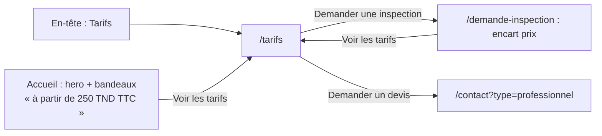

# Spec — Tarif public et page /tarifs

Statut : **validée le 2 oct. 2026 (maquettes v2 approuvées), implémentée sur feat/tarifs-page** · maquettes : https://claude.ai/artifact/7rVAdf36jp5EHqiLEdjm9c

## 1. Décisions du fondateur

Elles remplacent la décision n° 2 du 26 sept. 2026 (« Aucun prix sur le site », `docs/specs/2026-09-cta-demande-inspection.md`).

| # | Décision | Date |
|---|---|---|
| 1 | Inspection complète : **à partir de 250 TND TTC** | 1 oct. |
| 2 | 250 TND correspond à une **citadine**, en **inspection avant achat**, dans une zone où le déplacement est inclus | 2 oct. |
| 3 | Le prix varie selon le type de véhicule, sa valeur et l'objet de l'inspection. Le site nomme ces facteurs **sans montant** | 2 oct. |
| 4 | Déplacement inclus dans le **Grand Tunis** (Tunis, Ariana, Ben Arous, Manouba) et dans **tout le gouvernorat de Sfax**. Ailleurs : frais selon la zone, annoncés avant confirmation. Montants des zones non publiés | 1–2 oct. |
| 5 | Page dédiée `/tarifs`, lien « Tarifs » en 2ᵉ position dans l'en-tête | 2 oct. |
| 6 | Le prix ne dépend pas des défauts constatés (engagement publié dans la FAQ tarifs) | 2 oct. |
| 7 | Prix affichés TTC ; professionnels sur devis ; commission et prix de gros restent privés | 1 oct. |

Le traitement TVA des frais de déplacement reste à vérifier par le comptable.

## 2. Source unique

`src/data/pricing.js` est le seul endroit où le prix est écrit : prix d'appel, cas de base, facteurs, zones incluses, FAQ tarifs. Le site, les données structurées, le prompt du chatbot, les prompts des agents commerciaux et marketing, et le garde-fou `contains_price` le lisent tous depuis ce fichier. Seule exception : la migration `20261002100000_agent_knowledge_public_price.sql`, qui recopie le montant dans la base des agents.

Le prix se rattache toujours à l'**inspection complète** : des périmètres partiels existent (`PERIMETRES`) et ne sont pas tarifés.

## 3. Parcours

Le prix exact est annoncé au rappel (sous 24 h), d'après le véhicule, l'objet et la ville saisis dans la demande. Le formulaire ne calcule aucun prix : la ville reste un champ libre.

## 4. Emplacements

| Emplacement | Fichier | Contenu |
|---|---|---|
| En-tête | `Navigation.jsx` | Lien « Tarifs » |
| Page | `src/pages/Tarifs.jsx` | Prix d'appel et cas de base, facteurs, compris dans le prix, déplacement, professionnels, FAQ tarifs, bandeau final. JSON-LD `Offer` + `PriceSpecification` (minPrice 250 TND, TVA incluse, TN) et `FAQPage` |
| Hero | `HeroCertification.jsx` | « Inspection complète à partir de 250 TND TTC · Voir les tarifs » |
| Bandeaux | `InspectionCTA.jsx` | « À partir de 250 TND TTC · Voir les tarifs », sauf sur `/tarifs` (`showPrice={false}`) |
| Services | `Services.jsx` | Carte « Où que soit le véhicule » : déplacement sans frais dans les zones incluses |
| FAQ accueil | `homeFaqData.js` | « Combien coûte l'inspection ? » |
| Formulaire | `DemandeInspection.jsx` | Aide sous « Ville », étape 01 « Rappel sous 24 h, avec le prix », encart prix |
| Sitemap | `public/sitemap.xml` | `/tarifs` |

La barre mobile ne change pas. Sur `/tarifs`, le bouton de la carte prix est masqué sous `lg`, la barre mobile portant déjà « Demander une inspection ».

## 5. Agents

- **Chatbot** (`server/agents/chatbot/system-prompt-text.ts`) : section « Tarif public » rendue depuis `pricing.js`. Règle 7 : seul ce prix, avec son cas de base et ses facteurs ; jamais de prix exact pour un véhicule précis ; aucun autre montant ; professionnels sur devis.
- **Commercial et marketing** (prompts de génération et de correction) : seul le tarif public, avec un renvoi vers `/tarifs` ; pour un professionnel, aucun prix.
- **Garde-fou** (`server/agents/shared/guardrails.ts`) : `contains_price` laisse passer un montant égal à `BASE_PRICE_TND` et bloque tout autre montant en TND, DT ou dinars.
- **Base de connaissance** : la migration remplace deux phrases (`company`, `value_prop_b2c`) au lieu des lignes entières, pour garder les modifications faites depuis `/admin/knowledge`. Les segments professionnels gardent « aucun prix ».

## 6. Mesure

Les vues de `/tarifs` sont enregistrées comme toute page publique (`src/lib/analytics.js`). Le tableau de bord admin les montre dans le parcours : étape « Page Tarifs consultée », avec le nombre de visites qui ont ensuite ouvert le formulaire (migration `20261002110000_visit_stats_pricing.sql`, `api/admin/analytics.ts`, `HomepageAdminDashboard.jsx`).
